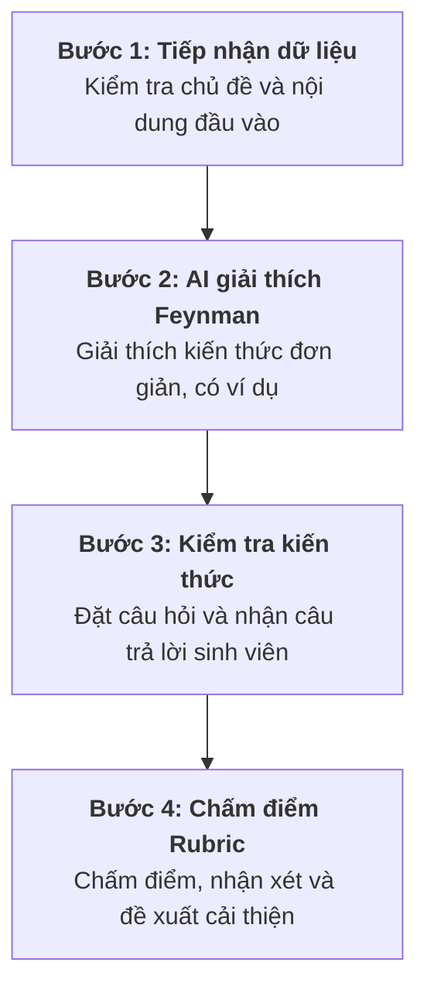

# [BTTH] Bài tập thực hành tổng hợp
## 1. Bối cảnh và mục tiêu
Xây dựng hệ thống AI hỗ trợ học tập theo phương pháp Feynman, kết hợp Rubric để tự động đánh giá kiến thức của sinh viên.

Hệ thống hoạt động qua nhiều bước liên kết với nhau, từ tiếp nhận chủ đề, giải thích kiến thức, kiểm tra mức độ hiểu bài đến chấm điểm và đưa ra nhận xét.

**Mục tiêu:**
- Giúp sinh viên hiểu kiến thức dễ dàng hơn.
- Tự động kiểm tra và chấm điểm theo Rubric.
- Hạn chế lỗi khi dữ liệu đầu vào không đầy đủ hoặc sai định dạng.
- Đảm bảo kết quả giữa các bước nhất quán.
## 2. Thiết kế quy trình Prompt Chaining
Hệ thống gồm 4 bước chính:

