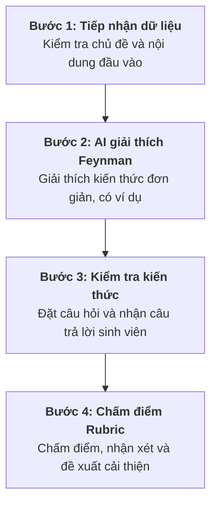

# [BTTH] Bài tập thực hành tổng hợp
## 1. Bối cảnh và mục tiêu
Xây dựng hệ thống AI hỗ trợ học tập theo phương pháp Feynman, kết hợp Rubric để tự động đánh giá kiến thức của sinh viên.

Hệ thống hoạt động qua nhiều bước liên kết với nhau, từ tiếp nhận chủ đề, giải thích kiến thức, kiểm tra mức độ hiểu bài đến chấm điểm và đưa ra nhận xét.

**Mục tiêu:**
- Giúp sinh viên hiểu kiến thức dễ dàng hơn.
- Tự động kiểm tra và chấm điểm theo Rubric.
- Hạn chế lỗi khi dữ liệu đầu vào không đầy đủ hoặc sai định dạng.
- Đảm bảo kết quả giữa các bước nhất quán.
## 2. Thiết kế quy trình Prompt Chaining
Hệ thống gồm 4 bước chính:

## 3. Xây dựng các Prompt thực thi
### Prompt 1: Tiếp nhận và kiểm tra dữ liệu
```text
Bạn là bộ phận tiếp nhận dữ liệu của hệ thống AI gia sư.

Hãy kiểm tra dữ liệu người học cung cấp:
- Chủ đề học tập.
- Nội dung cần giải thích.
- Trình độ người học.

Nếu thiếu chủ đề, yêu cầu người dùng bổ sung.
Nếu dữ liệu sai định dạng hoặc không rõ nghĩa, hãy thông báo và yêu cầu nhập lại.
Không tự suy đoán dữ liệu còn thiếu.

Đầu ra: Tóm tắt dữ liệu hợp lệ để chuyển sang bước 2.
```
### Prompt 2: Giải thích theo phương pháp Feynman
```text
Bạn là AI gia sư.

Dựa trên dữ liệu đã được kiểm tra ở bước 1, hãy:

1. Giải thích kiến thức bằng ngôn ngữ đơn giản.
2. Đưa ra một ví dụ thực tế.
3. Chỉ ra những điểm quan trọng cần nhớ.
4. Đặt 3 câu hỏi để kiểm tra mức độ hiểu bài.

Không sử dụng thuật ngữ phức tạp nếu chưa giải thích.
Không tự tạo thông tin khi không có căn cứ.

Đầu ra: Bài giải thích và 3 câu hỏi kiểm tra.
```
### Prompt 3: Tiếp nhận và phân tích câu trả lời
```text
Bạn là trợ lý phân tích câu trả lời của sinh viên.

Hãy đối chiếu câu trả lời với kiến thức ở bước 2.

Yêu cầu:
- Xác định nội dung đúng và chưa chính xác.
- Phát hiện câu trả lời thiếu ý hoặc không liên quan.
- Không tự bổ sung câu trả lời thay sinh viên.
- Nếu sinh viên chưa trả lời, yêu cầu bổ sung.
- Nếu câu trả lời bị lỗi định dạng, thông báo rõ.

Đầu ra: Bản phân tích câu trả lời để chuyển sang bước 4.
```
### Prompt 4: Chấm điểm bằng Rubric
```text
Bạn là giảng viên đánh giá kết quả học tập.

Dựa trên dữ liệu phân tích ở bước 3, hãy chấm điểm theo Rubric:

- Độ chính xác kiến thức: 4 điểm.
- Khả năng giải thích: 3 điểm.
- Ví dụ minh họa: 2 điểm.
- Cách trình bày: 1 điểm.

Quy định:
- Tổng điểm tối đa là 10.
- Chấm điểm dựa trên nội dung thực tế.
- Không tự nâng điểm khi thiếu dữ liệu.
- Không chấm những câu chưa được trả lời.
- Nếu dữ liệu không đủ, ghi rõ chưa thể đánh giá.

Đầu ra:
1. Bảng điểm từng tiêu chí.
2. Tổng điểm.
3. Nhận xét ưu điểm và hạn chế.
4. Ba đề xuất cải thiện.

Trình bày ngắn gọn, rõ ràng.
```
## 4. Cơ chế xử lý lỗi dữ liệu
|Trường hợp	|Cách xử lý|
|---|---|
|Thiếu chủ đề	|Yêu cầu nhập lại|
|Nội dung trống	|Không chuyển bước tiếp theo|
|Câu trả lời thiếu ý	|Đánh giá phần có dữ liệu|
|Sai định dạng	|Yêu cầu nhập lại|
|Câu trả lời không liên quan	|Ghi nhận và cảnh báo|
|AI không đủ căn cứ	|Không tự suy đoán|
## 5. Chạy thử và kết quả
**Dữ liệu đầu vào:**
- Chủ đề: Bộ nhớ RAM.
- Trình độ: Sinh viên năm nhất.
- Câu trả lời: RAM là bộ nhớ tạm thời dùng để lưu dữ liệu và chương trình đang chạy. Khi tắt máy, dữ liệu trong RAM sẽ mất.

**Kết quả sau khi chạy Prompt Chaining:**

---
### Bước 1 – Kiểm tra dữ liệu
Dữ liệu có chủ đề và trình độ học tập đầy đủ.
### Bước 2 – Giải thích Feynman
RAM là bộ nhớ tạm thời giúp máy tính lưu dữ liệu của các chương trình đang hoạt động. Có thể hiểu RAM giống như chiếc bàn làm việc, bàn càng rộng thì càng có nhiều chỗ để xử lý công việc cùng lúc.

Câu hỏi kiểm tra:
1. RAM dùng để làm gì?
2. Điều gì xảy ra khi tắt máy?
3. RAM có vai trò gì khi chạy nhiều ứng dụng?
### Bước 3 – Phân tích câu trả lời
- Đúng: Hiểu được chức năng của RAM.
- Đúng: Biết dữ liệu RAM mất khi tắt máy.
- Thiếu: Chưa giải thích rõ vai trò của RAM khi chạy nhiều ứng dụng.
- Thiếu: Chưa có ví dụ do sinh viên tự đưa ra.
### Bước 4 – Kết quả chấm Rubric
|Tiêu chí	|Điểm|
|---|---|
|Độ chính xác|	3.5/4|
|Giải thích	|2.5/3|
|Ví dụ	|0.5/2|
|Trình bày	|1/1|
|Tổng	|7.5/10|
---
